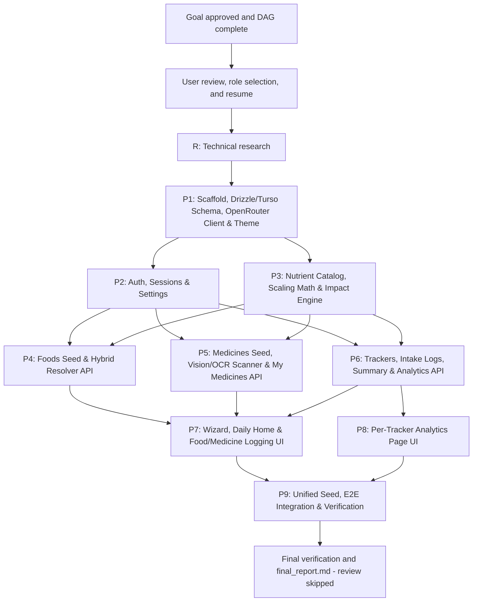

# State & Dependency Graph: Vitals & Nutrient Care Tracker (`vitals-tracker-v1`)

## Workflow configuration

- Workflow type: **MAW** (`workflow: maw`, pipelined multi-agent DAG execution).
- Keep all workflow artifacts directly in `docs/vitals-tracker-v1/`.
- Create no unnecessary directories; reuse standard Next.js App Router (`src/`) and `tests/` directories.
- Skipped phases declared: `--skip review` (Step 5 Unified Code Review is bypassed per user request).
- Mandatory phases: Brainstorming, planning, worker execution, and final verification remain required.
- Current authorization: **COMPLETE** — `/resume` on 2026-11-26; all phases finished. Goal, research, all nine plans, implementation, and final verification are complete. Remaining planning was completed manually after the GPT-6.2 Sol quota was exhausted.
- File preservation rules: Keep `.env.local` (if created by the user for Turso/OpenRouter secrets) strictly untracked in `.gitignore`; never commit API keys or local SQLite database files.
- Worker context policy (2026-11-26): from the next worker dispatch onward, keep the prompt minimal — plan path, owned files, exit gate, working directory, and TDD/commit/safety rules only. Do not include `research.md`, the full `goal.md`, or a research summary; the planner has already encoded the needed contracts into the plan. Planners still receive `goal.md`, `research.md`, and `state.md` scope.

## Delegation configuration & handoffs

- Harness: **OpenCode** (`subagent` delegation tool with `agent: explore | general` and an optional `model` as `provider/model[#variant]`; capability matrix row: OpenCode — exact provider/model ID plus a variant).
- Capability evidence: The exposed `subagent` schema accepts `model` (`providerID/modelID` or `providerID/modelID#variant`) and `agent`. `opencode models` enumerates the live provider/model catalog; model metadata in `~/.cache/opencode/models.json` advertises reasoning options where available. There is no separate effort parameter; effort is encoded as the optional `#variant` suffix. Antigravity's `invoke_subagent` is not available in this session, so the persisted Antigravity tier plan was replaced.
- Selection order: Researcher → Planner → Worker.
  - **Researcher:** `xai/grok-4.6#xhigh` (vendor-native Grok 4.6 with extra-high reasoning; Grok 4.6 advertises `low | medium | high | xhigh`).
  - **Planner:** **manual for all remaining plans (P7, P8, P9)**. GPT-6.2 Sol (`openai/gpt-6.2-sol#xhigh`) completed the P1–P6 plans and then hit its usage quota; on 2026-11-26 the user directed the remaining planning to manual handoffs. No automatic planner subagent will be spawned. P7/P8 are frontend plans; P9 is the integration/final-verification plan and its prompt is gated on the P7/P8 plan commits.
  - **Worker:** `harness-default` for both backend/foundation (P1–P6, P9) and frontend (P7–P8); no model override is passed.
  - The earlier harness-default entry was a mistake caused by treating the user's selection as a duplicate prompt answer; it has been corrected.
- Enforcement: **verified** for the researcher. The child session `ses_de9059acfffeuf1f38zpstQ1Y7` recorded `{"id":"grok-4.6","providerID":"xai","variant":"xhigh"}` in the OpenCode session database. The planner is now manual, so there is no automatic planner model to enforce; worker dispatches are harness-default and are checked as they run.
- Reviewer/fixer: Skipped (`--skip review`); not part of role selection.

| Handoff ID | Role | Plan/phase scope | Prompt reference | Expected artifacts | Status | Returned evidence |
| :--- | :--- | :--- | :--- | :--- | :--- | :--- |
| H-P7-PLAN | planner (manual) | P7 frontend plan | Chat: manual planner prompts, 2026-11-26 | `docs/vitals-tracker-v1/plan7.md` | verified | `6d16aa8`; only `plan7.md` changed |
| H-P8-PLAN | planner (manual) | P8 frontend plan | Chat: manual planner prompts, 2026-11-26 | `docs/vitals-tracker-v1/plan8.md` | verified | `503936d`; only `plan8.md` changed |
| H-P9-PLAN | planner (manual) | P9 integration plan | Chat: manual planner prompts, 2026-11-26 | `docs/vitals-tracker-v1/plan9.md` | verified | `85390e0`; only `plan9.md` changed |

*(All plans P1–P9 are verified and committed. P7 is complete; P8's worker is running; P9's worker is queued behind P8 and may start only after P8 finishes and commits. P9 planning is complete; no further planner dispatches are pending.)*

## Workflow milestones

- [x] Step 1: Brainstorming & Goal Alignment (`docs/vitals-tracker-v1/goal.md`; `c09da44`)
- [x] Step 2: Technical Research (`docs/vitals-tracker-v1/research.md`; `c201c69`)
- [x] Step 3: Planning Completed (all plans `plan1.md`–`plan9.md` written and committed; 2026-11-26)
- [x] Step 4: Execution Completed (all workers `P1`–`P9` finished and verified)
- [x] Step 5: Unified Code Review (Skipped via `--skip review`)
- [x] Step 6: Final Verification & Report (`docs/vitals-tracker-v1/final_report.md`; 2026-11-26)

## Brainstorming tasks

- [x] Explore project context: verified empty greenfield workspace, initialized git on `main`, checked Node `v24.18.0` and npm `12.0.1`.
- [x] Clarify requirements, edge cases, scope boundaries, medical safety, and platform.
- [x] Compare 3 architectural approaches and confirm recommended stack + Phase 1 scope.
- [x] Present design in 4 validated sections and incorporate user refinements.
- [x] Write and commit the validated `goal.md`: `c09da44`.
- [x] Self-check specification for completeness, consistency, ambiguity, and scope.
- [x] Construct the complete pre-research MAW DAG, disjoint file ownership, dependencies, exit gates, acceptance mapping, and resume procedure below.
- [x] Final user review of written `goal.md` and `state.md` + explicit resume authorization (`/resume`, 2026-11-26).

## Initial findings

- Greenfield project at `d:/Peter/Personal Stuffs/vitals-tracker`; git repository initialized on branch `main` with root commit `c09da44` (`docs/vitals-tracker-v1/goal.md`).
- Local runtime available: Node `v24.18.0`, npm `12.0.1`, Windows PowerShell 5.1 shell (commands should avoid bash-only `&&` chaining when executed in PowerShell).
- Production database target is **Turso** (hosted libSQL/SQLite free tier), making **Drizzle ORM + `@libsql/client`** superior to Prisma adapters for zero-friction local SQLite (`file:local.db`) ↔ Turso (`libsql://`) parity.
- Vision AI will run through the user's **OpenRouter API key** with a user-selectable vision model stored server-side/settings, plus an optional pluggable OCR fallback (`tesseract.js`).

## Confirmed product decisions

- **Primary persona:** Built for the user's mother (new to technology) and family caregivers—large readable typography (18px+ base), generous tap targets, forgiving Undo, zero technical jargon.
- **Custom trackers:** Users create multiple trackers via a guided step-by-step wizard (Name & optional Health Focus → Vitamins → Minerals → Essential Nutrients); each tracker shows only its selected nutrients.
- **Food logging:** Quantity in `g` or `ml` (with quick-tap presets) backed by a hybrid waterfall (saved/recent → curated regional & global local staples with aliases → open food API → OpenRouter AI estimation labeled *Estimated*), auto-caching confirmed foods.
- **Medicines & supplements:** Supports both supplements (contributing directly to daily vitamin/mineral totals) and prescription medicines (dose, schedule, plain-language food/nutrient notes). Scanning uses OpenRouter Vision AI primary + optional OCR fallback with mandatory 1-tap Confirm Card.
- **Repetitive medicines ("My Medicines"):** Any scanned or logged medicine is saved for 1-tap repeat logging on future days with zero repeated photo scans or API calls.
- **Safe condition-aware impact alerts:** Vital nutrients first, paired with deterministic directional nutritional cautions (e.g., high sugar for diabetes, high sodium for high BP)—never fabricating clinical mg/dL or mmHg numbers.
- **Visual design & Analytics:** Modern, minimalistic **dual-chromatic** color palette with **Light & Dark mode**, plus a per-tracker **Analytics** page (`7d` / `30d` trends, Needs Attention vs. On Track, caution days, medicine consistency).
- **Platform & accounts:** Mobile-first PWA with lightweight accounts + persistent `HttpOnly` sessions so family members can help configure trackers remotely while the OpenRouter key stays safely server-side.
- **Workflow choice:** Convert into **MAW** workflow with `--skip review`, and pause right after committing `goal.md` and `state.md`.

## Dependency matrix & execution status

This is the research-reconciled DAG (`dag_status: research-reconciled`, research commit `c201c69`). The execution graph is unchanged; P1 ownership and scope absorbed the verified version pins and manual-scaffold constraint. All parallelizable plans (`P2`‖`P3`, `P4`‖`P5`‖`P6`, and `P7`‖`P8`) have **strictly disjoint file ownership**; `P1` installs all planned npm dependencies upfront in `package.json` so downstream parallel workers never contend on `package.json` or lockfiles.

`R` means technical research completed and committed. `P#` worker dependencies mean prerequisite implementation is completed, verified, and committed. Planner dependencies are separately defined so planning and ready workers can overlap.

| Plan ID | Title & Scope | Worker dependencies | Touched files / subsystems | Planner status | Worker status | Commits |
| :--- | :--- | :--- | :--- | :--- | :--- | :--- |
| **P1** | Project Scaffold, Drizzle/Turso Schema, OpenRouter Client & Dual-Chromatic Theme Foundation | R | `package.json`, `next.config.ts`, `tsconfig.json`, `vitest.config.ts`, `vitest.setup.ts`, `drizzle.config.ts`, `postcss.config.mjs`, `eslint.config.mjs`, `.env.example`, `.gitignore`, `public/manifest.json`, `public/sw.js`, `public/icons/*`, `src/db/index.ts`, `src/db/schema.ts`, `src/db/test-utils.ts`, `src/lib/env.ts`, `src/lib/openrouter/*`, `src/app/layout.tsx`, `src/app/globals.css`, `src/components/theme-provider.tsx`, `src/components/ui/*`, `tests/db-schema.test.ts` | [x] `5433c0b` | [x] Complete | 8 commits: `59fbab9`…`53eabe7`, `d1c2029` |
| **P2** | Lightweight Auth, Persistent Sessions & User Settings | P1 | `src/lib/auth/*`, `src/app/api/auth/**`, `src/app/api/settings/route.ts`, `src/app/(auth)/login/page.tsx`, `src/app/(auth)/signup/page.tsx`, `src/app/settings/page.tsx`, `tests/auth.test.ts` | [x] `537de94` | [x] Complete | `979647d`, `3542f65`, `ba09ac6`, `301e5fa` (shared), `69993e5`, `2b5c839`, `6f37158` |
| **P3** | Canonical Nutrient Catalog, Scaling Math & Condition Impact Engine | P1 | `src/lib/nutrients/*`, `src/lib/impact/*`, `tests/nutrients.test.ts`, `tests/impact-engine.test.ts` | [x] `04975e6` | [x] Complete | `dacffe6`, `4afe41d`, `7ca0438`, `3d1d602`, `301e5fa` (shared) |
| **P4** | Curated Food Catalog & Hybrid Food Resolver API | P2, P3 | `src/db/seed-foods.ts`, `src/lib/foods/*`, `src/app/api/foods/**`, `tests/food-resolver.test.ts` | [x] `74d09bd` | [x] Complete | `93afb17`, `4132493`, `73ef8e0`, `b79da51`, `c7b44d9`, `25e7a3d`, `8654ec2`, `c17693e` |
| **P5** | Curated Medicines, OpenRouter Vision Scanner, OCR Fallback & "My Medicines" API | P2, P3 | `src/db/seed-medicines.ts`, `src/lib/medicines/*`, `src/app/api/medicines/**`, `tests/medicine-recognizer.test.ts`, `tests/medicines-api.test.ts` | [x] `03f32c0` | [x] Complete | `2a7f01b`, `8d4225b`, `f46cec4`, `44b545b`, `67c9716`, `81a172f`, `3a731dc`, `63df95a` |
| **P6** | Trackers CRUD, Intake Logs, Daily Summary & Analytics API | P2, P3 | `src/lib/trackers/*`, `src/lib/analytics/*`, `src/app/api/trackers/**`, `tests/trackers-api.test.ts`, `tests/analytics.test.ts` | [x] `87393e9` | [x] Complete | `7ee795d`, `849eca1`, `0db6346`, `69199b9`, `a372e4a`, `cf47f91`, `44f0a1b`, `27890dd` |
| **P7** | Trackers Home, Guided Wizard, Daily View, Food/Medicine Logging & Confirm Card UI | P4, P5, P6 | `src/app/page.tsx`, `src/app/trackers/new/page.tsx`, `src/app/trackers/[id]/layout.tsx`, `src/app/trackers/[id]/page.tsx`, `src/components/wizard/*`, `src/components/trackers/*`, `src/components/logging/*`, `tests/tracker-ui.test.tsx` | [x] `6d16aa8` | [x] Complete | `337f0be`, `8b5394f`, `965b5f3`, `182b858`, `31b3a30`, `33119cd`, `71b10ec`, `4c321ec`, `3ed76e9`, `758a709`, `131b132` |
| **P8** | Per-Tracker Analytics Page UI (`7d` / `30d` Dual-Chromatic Charts & Insights) | P6 | `src/app/trackers/[id]/analytics/page.tsx`, `src/components/analytics/*`, `tests/analytics-ui.test.tsx` | [x] `503936d` | [x] Complete | `c8ae2e2`, `92523f1`, `0c68e70`, `5d97669`, `2463429`, `01486e1` |
| **P9** | Unified Seed Runner, E2E Integration Tests, Setup Docs & Full Verification | P7, P8 | `src/db/seed.ts`, `tests/e2e-flows.test.ts`, `README.md` | [x] `85390e0` | [x] Complete | `5088254`, `1046396`, `cf1f0d9`, `190d0be`, `bf120a4` |

*(Note on statuses: Planner status updates to `[x] <hash>` once the planner commits; Worker status updates to `[x] Complete` once the worker finishes and tests pass).*

### Execution graph

### Planner readiness and immediate worker dispatch

| Planner | Earliest planning prerequisites after resume | Worker start condition |
| :--- | :--- | :--- |
| **P1** | R committed | P1 plan committed |
| **P2** | P1 worker committed | P2 plan committed and P1 complete |
| **P3** | P1 worker committed | P3 plan committed and P1 complete |
| **P4** | P2 and P3 workers committed | P4 plan committed; P2 and P3 complete |
| **P5** | P2 and P3 workers committed | P5 plan committed; P2 and P3 complete |
| **P6** | P2 and P3 workers committed | P6 plan committed; P2 and P3 complete |
| **P7** | P4, P5, and P6 plans committed (or workers complete) | P7 plan committed; P4, P5, and P6 workers complete |
| **P8** | P6 plan committed (or worker complete) | P8 plan committed; P6 worker complete |
| **P9** | P7 and P8 plans committed | P9 plan committed; P7 and P8 workers complete |

- Dispatch independent planners concurrently in foreground parallel (`P2`‖`P3`, `P4`‖`P5`‖`P6`, `P7`‖`P8`).
- Start each ready worker immediately when its plan is committed and worker prerequisites are met; do not wait for unrelated planners.
- Workers with disjoint write ownership may be implemented in parallel, but because worker subagents commit to the same git index, run implementation workers sequentially (one at a time) to serialize commits. The 2026-11-26 P2/P3 parallel run produced mixed commit `301e5fa`; do not repeat that. Planners may still run concurrently because they commit only their own plan documents.
- Serialize git staging/commits, even for disjoint workers, to avoid shared-index collisions.
- A changed upstream contract pauses affected downstream work until plans/types are reconciled.

## Plan scopes, file ownership, and completion gates

### P1 — Project Scaffold, Drizzle/Turso Schema, OpenRouter Client & Dual-Chromatic Theme Foundation
**Deliverable:** `plan1.md`; runnable Next.js TypeScript PWA foundation, complete Drizzle/libSQL schema (local SQLite + Turso), shared server OpenRouter HTTP client, and dual-chromatic Light/Dark design tokens.  
**Owned files:**
- `package.json`, `package-lock.json`, `next.config.ts`, `tsconfig.json`, `vitest.config.ts`, `vitest.setup.ts`, `drizzle.config.ts`, `postcss.config.mjs`, `eslint.config.mjs`, `.env.example`, `.gitignore`
- `public/manifest.json`, `public/sw.js`, `public/icons/*`
- `src/db/index.ts`, `src/db/schema.ts`, `src/db/test-utils.ts`
- `src/lib/env.ts`, `src/lib/openrouter/client.ts`, `src/lib/openrouter/models.ts`
- `src/app/layout.tsx`, `src/app/globals.css`, `src/components/theme-provider.tsx`, `src/components/ui/*`
- `tests/db-schema.test.ts`  
**Scope:** Bootstrap Next.js App Router + Tailwind + Vitest + all planned dependencies (`drizzle-orm`, `drizzle-kit`, `@libsql/client`, `zod`, `recharts`, `lucide-react`, `tesseract.js`, `@testing-library/react`, `jsdom`) so parallel downstream plans never touch `package.json`. **Research-reconciled pins:** Next `16.4.6`, React/React DOM `19.3.1`, TypeScript `7.0.2`, Tailwind `4.3.5`, Zod `4.6.7`, Drizzle ORM `0.45.4`, drizzle-kit `0.31.11`, `@libsql/client` `0.18.0`, Vitest `5.1.2`, ESLint `9.39.5`, `@types/node@24`; Node `>=24.15`; do not use Drizzle v1 RC or `@tursodatabase/*`. `create-next-app` refuses this non-empty repo, so scaffold the files manually. Set `serverExternalPackages: ['@libsql/client', 'libsql', 'tesseract.js']` and use the Node.js runtime. Implement all 7 Drizzle tables, libSQL connection helper (local `file:local.db` + Turso `libsql://`), in-memory test DB harness, server-only OpenRouter client (20s timeout, model allow-list, structured JSON extraction), PWA manifest/service worker registration, and dual-chromatic Light/Dark theme shell (`18px` base typography, `UndoToast`, accessible button/card primitives).  
**Plan contract notes (`plan1.md`, `5433c0b`):** the temporary `/` fallback must yield to P7's real homepage and be verified by a production build/smoke test; DB factories are async and tests apply Drizzle migration SQL entirely in memory while committed migration history stays outside P1 ownership; deleting a food or medicine clears its log reference without altering the historical nutrient snapshot.  
**Worker result (8 commits, `59fbab9`…`53eabe7`, `d1c2029`):** typecheck, build, `tests/db-schema.test.ts` (12/12), `src/components/ui/foundation.test.tsx` (4/4), and `npm test` (16/16) pass. The lint blocker was fixed with the official TypeScript 7.0 side-by-side aliases: `typescript` → `@typescript/typescript6@6.0.2` for the ESLint API, and `@typescript/native` → `typescript@7.0.2` so `tsc` remains TS 7. `npm run lint` now exits 0 with one non-blocking warning (`postcss.config.mjs` anonymous default export); `npx tsc --version` reports 7.0.2 and `require('typescript').version` reports 6.0.3. Orchestrator re-ran the full gate: lint 0 errors, typecheck pass, db-schema 12/12, npm test 16/16, build pass.  
**Known non-blocking warnings for P9 cleanup:** `postcss.config.mjs` `import/no-anonymous-default-export`; Vite's `configLoader` ESM-in-CJS warning for `vitest.config.ts`.  
**Exit gate:** `npm run typecheck`, `npm run build`, and `npx vitest run tests/db-schema.test.ts` pass, proving all 7 tables migrate and round-trip cleanly in in-memory libSQL.

### P2 — Lightweight Auth, Persistent Sessions & User Settings
**Deliverable:** `plan2.md`; secure `scrypt` auth, persistent 90-day `HttpOnly` sessions, `requireUser()` guard, login/signup UI, and Settings page (theme + OpenRouter vision model picker + medical safety notice).  
**Owned files:**
- `src/lib/auth/password.ts`, `src/lib/auth/session.ts`, `src/lib/auth/schemas.ts`
- `src/app/api/auth/signup/route.ts`, `src/app/api/auth/login/route.ts`, `src/app/api/auth/logout/route.ts`, `src/app/api/auth/me/route.ts`
- `src/app/api/settings/route.ts`
- `src/app/(auth)/login/page.tsx`, `src/app/(auth)/signup/page.tsx`, `src/app/settings/page.tsx`
- `tests/auth.test.ts`  
**Scope:** Implement account registration/login/logout with salted `scrypt` password hashes and hashed session tokens in `sessions`, long-lived `HttpOnly` / `SameSite=Lax` cookies, strict `requireUser()` helper returning `401` for unauthenticated requests, and `/settings` UI for Light/Dark/System theme switching, OpenRouter vision model selection (allow-listed vision models + custom model ID), and the plain-language medical disclaimer.  
**Plan contract notes (`plan2.md`, `537de94`):** `requireUser()` returns `{ ok: true, user }` or `{ ok: false, response }` with a `401`; downstream queries scope by `user.id`. Sessions expire after 90 days without renewal; cookies are `Secure` in production; logout revokes only the presented session. Settings `PATCH` accepts a partial update; `visionModel: null` restores the deployment default. P7 owns auth/settings links and theme reconciliation on the tracker landing page. Rate-limit signup/login at the production ingress (out of application scope).  
**Worker result:** `tests/auth.test.ts` 12/12, typecheck pass, `npm test` 47/47. Settings envelope is `{ settings, visionModels, defaultVisionModel }`; cookie name is `vt_session`, host-only/HttpOnly/SameSite=Lax/Secure in production. Browser smoke was not run; defer to P7/P9.  
**Exit gate:** `npx vitest run tests/auth.test.ts` passes, verifying signup, duplicate-email rejection, login/logout, persistent session resolution, unauthorized `401` enforcement, and settings update persistence.

### P3 — Canonical Nutrient Catalog, Scaling Math & Condition Impact Engine
**Deliverable:** `plan3.md`; zero-dependency canonical nutrient catalog, exact `g`/`ml`/dose calculation engine, and deterministic condition-aware directional alert engine.  
**Owned files:**
- `src/lib/nutrients/catalog.ts`, `src/lib/nutrients/calculator.ts`, `src/lib/nutrients/types.ts`
- `src/lib/impact/engine.ts`, `src/lib/impact/types.ts`
- `tests/nutrients.test.ts`, `tests/impact-engine.test.ts`  
**Scope:** Define all selectable Vitamins (A, B1, B2, B3, B6, B9, B12, C, D, E, K), Minerals (Calcium, Iron, Magnesium, Potassium, Sodium, Zinc, Iodine, Selenium, Phosphorus), and Essential Nutrients (Protein, Fiber, Total Sugars, Added Sugars, Carbohydrates, Healthy Fats, Water) with units and default adult targets; implement `g`/`ml` scaling (`1 ml = 1 g` fallback), supplement dose scaling, full-day nutrient aggregation, and `impact-engine` rules evaluating full daily totals for `diabetes` (sugar load) and `hypertension` (sodium load) cautions—strictly directional nutritional messages, never simulated clinical readings.  
**Plan contract notes (`plan3.md`, `04975e6`):** canonical units — `vitaminA` mcg RAE, `vitaminB3` mg NE, `vitaminB9` mcg DFE, `vitaminB12`/`vitaminD`/`vitaminK`/`iodine`/`selenium` mcg; `vitaminB1`/`vitaminB2`/`vitaminB6`/`vitaminC`/`vitaminE`/`calcium`/`iron`/`magnesium`/`potassium`/`sodium`/`zinc`/`phosphorus` mg; `protein`/`fiber`/`totalSugars`/`addedSugars`/`carbohydrates`/`healthyFats`/`water` g. Diabetes cautions trigger above 35 g total sugars **or** 25 g added sugars; hypertension above 2,000 mg sodium. Equality and floating-point noise do not trigger; alerts evaluate full-day totals before display rounding and never report clinical readings.  
**Worker result:** targeted suite 19/19, `npm run typecheck` pass, `npm test` 47/47 at worker completion. **Commit hygiene deviation:** P3 Task 5 files were swept into P2's `301e5fa` during a concurrent index-lock race; the diff is correct. P2 has later commits on top, so history was not rewritten while P2 was active. The mixed commit is documented here; final verification runs on the tree, not on commit boundaries.  
**Exit gate:** `npx vitest run tests/nutrients.test.ts tests/impact-engine.test.ts` passes with 100% coverage of scaling edge cases, rounding, combined food + supplement sums, and Diabetes/High-BP threshold boundaries with zero false alarms.

### P4 — Curated Food Catalog & Hybrid Food Resolver API
**Deliverable:** `plan4.md`; curated regional/global staple foods seed module and hybrid waterfall food search/resolve/cache APIs.  
**Owned files:**
- `src/db/seed-foods.ts`
- `src/lib/foods/resolver.ts`, `src/lib/foods/schemas.ts`, `src/lib/foods/open-api.ts`
- `src/app/api/foods/search/route.ts`, `src/app/api/foods/resolve/route.ts`, `src/app/api/foods/route.ts`
- `tests/food-resolver.test.ts`  
**Scope:** Curate ~100+ everyday regional home-cooked & global staple foods with common aliases (e.g., *roti/chapati*, *curd/dahi*, *idli*, *dal*, *milk*, *banana*, *rice*, *egg*, *spinach/palak*) and per-100g/ml profiles. Implement `GET /api/foods/search` (user saved/recent + local alias match), `POST /api/foods/resolve` (open food DB lookup → OpenRouter AI fallback returning *Estimated* draft validated by `zod`), and `POST /api/foods` (save/cache user-confirmed food scoped by `userId`).  
**Plan contract notes (`plan4.md`, `74d09bd`):** 129 curated profiles; authenticated local-only search via `GET /api/foods/search`. `POST /api/foods/resolve` checks saved and curated foods, then Open Food Facts, optional USDA, then OpenRouter; AI results are labeled **Estimated**; resolve never saves or logs. `POST /api/foods` caches explicit confirmations per user, normalized name, and unit; the first confirmation wins; intake logging remains separate. Open Food Facts limits are enforced per process; deployments sharing an outbound IP need a shared limiter.  
**Worker result:** 11/11 food-resolver tests, typecheck pass, `npm test` 75/75, build/lint pass. One fixture correction: added `bhindi masala` to recipe 17's aliases because the plan's test required it. P9 follow-up: verify Node CLI module resolution for the `.ts`-extension relative imports used by `seed-foods.ts` on Node 24/Windows.  
**Exit gate:** `npx vitest run tests/food-resolver.test.ts` passes with mocked external/OpenRouter fixtures, confirming alias matching, waterfall order, Zod rejection of malformed AI payloads, and automatic confirmed-food caching.

### P5 — Curated Medicines, OpenRouter Vision Scanner, OCR Fallback & "My Medicines" API
**Deliverable:** `plan5.md`; pluggable medicine recognizer (`OpenRouterVisionProvider` + `OcrFallbackProvider`), server-side image validation, curated starter supplements/meds, and "My Medicines" cabinet CRUD APIs.  
**Owned files:**
- `src/db/seed-medicines.ts`
- `src/lib/medicines/types.ts`, `src/lib/medicines/schemas.ts`, `src/lib/medicines/openrouter-vision.ts`, `src/lib/medicines/ocr-fallback.ts`, `src/lib/medicines/recognizer.ts`
- `src/app/api/medicines/route.ts`, `src/app/api/medicines/[id]/route.ts`, `src/app/api/medicines/scan/route.ts`
- `tests/medicine-recognizer.test.ts`, `tests/medicines-api.test.ts`  
**Scope:** Implement strict image validation (`image/jpeg`, `image/png`, `image/webp`, ≤ 2 MB, processed strictly in-memory with zero disk writes), OpenRouter Vision structured extraction (brand/generic name, `supplement` | `prescription` | `both`, per-dose vitamin/mineral map, plain-language food/nutrient notes, confidence level), optional Tesseract.js OCR fallback + catalog matching, never auto-logging scan results, and authenticated CRUD for the user's **My Medicines** cabinet (`GET/POST /api/medicines`, `PATCH/DELETE /api/medicines/[id]`).  
**Plan contract notes (`plan5.md`, `03f32c0`):** scan is authenticated and in-memory; it returns a draft or recovery actions with `requiresConfirmation: true` and never saves a medicine or logs intake. Confidence is high ≥0.85, medium ≥0.60, otherwise low; incomplete drafts are capped at low. OCR is an explicit `?mode=ocr` retry through a pluggable Tesseract provider with no disk cache; catalog matches are low confidence and never supply a dose or nutrient amount. Cold-start OCR failure falls back to manual entry.  
**Worker result:** 18/18 medicine tests, typecheck pass, `npm test` 93/93, build/lint pass. All commits touch only the eight P5-owned files; no deviations.  
**Exit gate:** `npx vitest run tests/medicine-recognizer.test.ts tests/medicines-api.test.ts` passes, verifying MIME/size rejection, valid/partial/low-confidence/malformed OpenRouter fixtures, OCR fallback behavior, and strict user-isolated "My Medicines" CRUD.

### P6 — Trackers CRUD, Intake Logs, Daily Summary & Analytics API
**Deliverable:** `plan6.md`; full tracker lifecycle APIs, local-date intake logging with immutable nutrient snapshots, daily summary with `impact-engine` alerts, and `7d`/`30d` analytics rollups.  
**Owned files:**
- `src/lib/trackers/service.ts`, `src/lib/trackers/schemas.ts`
- `src/lib/analytics/service.ts`, `src/lib/analytics/types.ts`
- `src/app/api/trackers/route.ts`, `src/app/api/trackers/[id]/route.ts`
- `src/app/api/trackers/[id]/logs/route.ts`, `src/app/api/trackers/[id]/logs/[logId]/route.ts`
- `src/app/api/trackers/[id]/summary/route.ts`, `src/app/api/trackers/[id]/analytics/route.ts`
- `tests/trackers-api.test.ts`, `tests/analytics.test.ts`  
**Scope:** Implement tracker creation (selected vitamins/minerals/essential nutrients + targets + health flags), editing/deletion, intake logging (`food` by `g`/`ml` and `medicine` by `dose`, storing full immutable `computedNutrientsJson` and local `logDate`), quantity editing & Undo deletion, daily summary endpoint (filtering progress cards to `tracker_nutrients` while evaluating `impact-engine` across full daily totals), and `7d`/`30d` analytics rollup endpoint (daily series, average completion, Needs Attention vs. On Track, caution days, medicine adherence). Strictly enforce `userId` ownership on every route.  
**P6 integration risk from P3:** `tracker_nutrients` currently stores `dailyTarget` without explicit-vs-default provenance. P6 must preserve that distinction (an additive schema flag such as `isCustomTarget`/`targetSource`, or an equivalent API/UI contract) so untouched catalog defaults never override the impact engine's caution thresholds; comparing values alone misses explicit targets equal to defaults. Any additive schema change is an exception to P1 file ownership and must be backward-compatible, tested, and noted in the P6 plan.  
**Plan contract notes (`plan6.md`, `87393e9`):** owner-scoped tracker CRUD; local-date intake logs; quantity edits use historical snapshots; Undo is a deletion. Daily summaries evaluate all nutrients for cautions while displaying only selected ones. Target provenance is an additive `isCustomTarget` flag defaulting to `false` for legacy rows; untouched defaults never override caution thresholds, while explicit targets can even when they equal catalog defaults. Analytics use inclusive 7/30-day windows, count empty days in capped goal averages, exclude upper limits from completion, count each caution date once, and measure medicine consistency by distinct logged days.  
**Worker result:** 17/17 tracker/analytics tests, typecheck pass, `npm test` 64/64, build/lint pass. The additive `isCustomTarget` schema column and legacy SQL are the only schema change.  
**Exit gate:** `npx vitest run tests/trackers-api.test.ts tests/analytics.test.ts` passes, verifying cross-user isolation, local-date bucketing, food + supplement aggregation, Undo deletion, condition alert generation, and `7d`/`30d` analytics math.

### P7 — Trackers Home, Guided Wizard, Daily View, Food/Medicine Logging & Confirm Card UI
**Deliverable:** `plan7.md`; complete mother-first mobile/desktop UI for tracker management, 4-step guided wizard, Daily Today screen, food `g`/`ml` logging, medicine photo scan + Confirm Card, and 1-tap "My Medicines" logging.  
**Owned files:**
- `src/app/page.tsx`, `src/app/trackers/new/page.tsx`, `src/app/trackers/[id]/layout.tsx`, `src/app/trackers/[id]/page.tsx`
- `src/components/wizard/*`
- `src/components/trackers/*` (`caution-banner.tsx`, `nutrient-progress-card.tsx`, `daily-log-list.tsx`, `tracker-tabs.tsx`)
- `src/components/logging/*` (`food-log-modal.tsx`, `medicine-log-modal.tsx`, `medicine-confirm-card.tsx`, `image-compress.ts`)
- `tests/tracker-ui.test.tsx`  
**Scope:** Build effortless, minimalistic, dual-chromatic Light/Dark views with ≥48px touch targets: Trackers dashboard (`/`), 4-step Create Tracker Wizard (`/trackers/new`), Tracker layout (`Today` | `Analytics` tabs), Today view (date switcher, Condition Caution Banner, selected-only nutrient cards, Today's Log with edit/delete + 8-second Undo toast), Food modal (recent/search + AI fallback + `g`/`ml` presets + live preview), and Medicine modal (**My Medicines** 1-tap list on top + client-compressed camera/upload scan → **Medicine Confirm Card** with confidence badge, Retake, OCR fallback, and manual entry recovery).  
**Plan contract notes (`plan7.md`, `6d16aa8`):** P1's global header has no nav links, so P7 adds accessible ≥48px Trackers/Settings links in its own pages. Existing-log deletion Undo uses an 8-second client-deferred DELETE with `keepalive` (flush on supersede/date switch/unmount); newly added logs use the immediate DELETE. `IntakeLog` lacks medicine `defaultDoseLabel`/`category`, so the UI formats "1 dose"/"N doses", surfaces `medicineNotes`, and highlights supplement nutrient amounts. Log PATCH edits quantity only. Food save is a strict schema requiring ≥1 nutrient: drafts strip provider/label/estimated fields, and manual entry falls back to common nutrient fields. Medicine creation rejects empty-string optional text, so blanks normalize to null. The header theme persists to localStorage; `/` reconciles the DB theme only when no local preference exists.  
**Worker result:** 14/14 tracker UI tests, typecheck pass, `npm test` 107/107, build/lint pass. Fixed `event.currentTarget` nulling inside state updaters; gated the canvas probe on `createImageBitmap`; switched initial loads to reload-token effects for `react-hooks/set-state-in-effect`; typed test fixtures. The tracker layout already used a non-`<main>` wrapper, so no P8 interop change was needed. No analytics files or backend files changed.  
**Exit gate:** `npx vitest run tests/tracker-ui.test.tsx` and `npm run typecheck` pass, verifying wizard steps, food preview math, Confirm Card explicit confirmation, 1-tap repeat medicine logging, and error recovery states.

### P8 — Per-Tracker Analytics Page UI (`7d` / `30d` Dual-Chromatic Charts & Insights)
**Deliverable:** `plan8.md`; clean, easily digestible per-tracker Analytics page consuming `GET /api/trackers/[id]/analytics`.  
**Owned files:**
- `src/app/trackers/[id]/analytics/page.tsx`
- `src/components/analytics/range-toggle.tsx`, `src/components/analytics/nutrient-trend-chart.tsx`, `src/components/analytics/attention-summary.tsx`, `src/components/analytics/medicine-adherence-card.tsx`, `src/components/analytics/caution-days-strip.tsx`
- `tests/analytics-ui.test.tsx`  
**Scope:** Build `/trackers/[id]/analytics` using the dual-chromatic theme tokens in Light & Dark mode: `7 Days` / `30 Days` toggle, clear summary metrics (average goal completion, active days, caution days), **Needs Attention** vs. **On Track** plain-language cards, interactive nutrient chip selector + Recharts trend chart with target line, caution-day indicators, medicine adherence consistency card, and calm empty-state guidance for brand-new trackers.  
**Plan contract notes (`plan8.md`, `503936d`):** the analytics payload lacks `tracker.name`/`healthFlags`, so P8 renders self-contained with a Back-to-Today link and owns `<main>`; P7's tracker layout must use a non-`<main>` wrapper + `<nav>` (follow-up sent to the P7 worker). The API requires a mandatory local `endDate` (`YYYY-MM-DD`); compute it with local calendar fields, not UTC `toISOString`. `averageCompletionPct` is `0` when `activeDays === 0` but goal nutrients exist, and `null` when only upper-reference nutrients/medicines exist; gate the empty state on `activeDays === 0` and show `—` for null. Trend `dailyTarget` uses catalog defaults (2300 mg sodium, 50 g added sugars) while the impact engine warns at 2000 mg/25 g and `NutrientTrend` exposes no `impactThreshold`; show each alert's exact `trigger.threshold` in `CautionDaysStrip` and label the chart line "Daily limit reference". Historical alert copy says "today"; keep backend strings intact and scope them under explicit calendar-date headings with numeric trigger breakdowns. `medicineAdherence` includes only medicines logged in the window; report "Logged X of N days" without missed-dose/schedule claims. All client files use `import type` only from `@/lib/analytics/types` because it references the server-only tracker service.  
**Worker result:** 13/13 analytics UI tests, typecheck pass, `npm test` 120/120, build/lint pass. Only the seven owned files changed; `import type` boundary respected.  
**Exit gate:** `npx vitest run tests/analytics-ui.test.tsx` and `npm run typecheck` pass, verifying empty, normal, and high-caution analytics rendering states.

### P9 — Unified Seed Runner, E2E Integration Tests, Setup Docs & Full Verification
**Deliverable:** `plan9.md`; idempotent local/Turso seed CLI, full cross-plan integration test suite, setup documentation, and final build/lint/test verification.  
**Owned files:**
- `src/db/seed.ts`
- `tests/e2e-flows.test.ts`
- `README.md`  
**Scope:** Wire idempotent `npm run db:seed` combining `seed-foods.ts` and `seed-medicines.ts` (works on both local SQLite and Turso); write end-to-end integration tests covering the complete lifecycle (signup → guided tracker wizard → food `g`/`ml` log → Vision scan & confirm supplement + prescription → 1-tap repeat medicine log → Diabetes & High-BP alert evaluation → `7d`/`30d` analytics → Undo & edit); author `README.md` covering local SQLite setup, Turso env vars, OpenRouter API key & vision model config, and phone home-screen PWA install steps.  
**P4 follow-up:** verify Node 24/Windows module resolution for the `.ts`-extension relative imports used by `seed-foods.ts` and the seed runner; use the supported Node TypeScript/loader approach or adjust only the import specifiers without changing the curated profiles.  
**Plan contract notes (`plan9.md`, `85390e0`):** resolve seed imports inside P9-owned `src/db/seed.ts` with Node 24's `node:module` `registerHooks({ resolve })` before dynamic imports; handle `.ts`-extension imports and directory imports with `statSync(...).isFile()` so `@/db` resolves to `src/db/index.ts`, leaving P1/P4/P5 files untouched. No committed Drizzle migration journal exists; README documents `npm run db:push` (or `db:generate` + `db:migrate`) before `db:seed`, and the legacy SQL file is only for pre-P6 upgrades; the seed prints a remediation hint when tables are missing. On Windows use `pathToFileURL(tempDbPath).href` for libSQL, retry-guarded `rmSync` after `client.close()`, and `fileURLToPath(import.meta.url)` for `repoRoot`. The P9 worker must start only after P7/P8 workers finish because its gate validates the whole repo. README includes `NEXT_PUBLIC_APP_URL` for OpenRouter HTTP-Referer/Open Food Facts User-Agent, optional `USDA_FDC_API_KEY`, ODbL/SR28 attribution, Node `>=24.15.0`, and the medical disclaimer. E2E tests stub `globalThis.fetch`, never touch live providers/Turso, and never write repo DB files. Known P1 warnings (`postcss.config.mjs`, Vite CJS loader) remain out of P9 ownership; all four gate commands must exit 0.  
**Worker result:** 7 E2E tests, `npm test` 127/127, typecheck/lint/build pass. Only the three P9-owned files changed; no DB files or secrets generated. Deviations: typed the CLI env as `NodeJS.ProcessEnv` for TS7; corrected the plan's expected empty-alert assertion because the test diary totals 36.67 g sugars and correctly fires the diabetes caution; actual test count is 6, not the plan's 5.  
**Exit gate:** `npm test`, `npm run typecheck`, `npm run lint`, and `npm run build` all pass with zero errors.

## Acceptance coverage

| Goal criterion | Primary owner(s) | Integrated verification |
| :--- | :--- | :--- |
| **AC1:** Lightweight Auth, Persistent Session & User Isolation | P2 | P6, P9, Final verification |
| **AC2:** Guided Custom Tracker Wizard (Selected Nutrients Only) | P3, P6, P7 | P9, Final verification |
| **AC3:** Food Logging (`g`/`ml`) & Hybrid Resolver + Caching | P3, P4, P7 | P9, Final verification |
| **AC4:** Medicine Photo Scan (OpenRouter Vision + OCR Fallback + Confirm Card) | P1, P5, P7 | P9, Final verification |
| **AC5:** Supplements (Nutrient Totals) & Prescription Meds (Dose + Notes) | P3, P5, P6, P7 | P9, Final verification |
| **AC6:** 1-Tap Repetitive Medicines ("My Medicines" Cabinet) | P5, P7 | P9, Final verification |
| **AC7:** Safe Condition-Aware Impact Alerts (Diabetes / High BP) | P3, P6, P7 | P9, Final verification |
| **AC8:** Local-Date (`YYYY-MM-DD`) Logs, Snapshots, Edit & Undo | P1, P6, P7 | P9, Final verification |
| **AC9:** Per-Tracker Analytics Page (`7d`/`30d` Charts, Needs Attention, Adherence) | P6, P8 | P9, Final verification |
| **AC10:** Modern Minimalistic Dual-Chromatic Light/Dark Accessible PWA | P1, P2, P7, P8 | P9, Final verification |
| **AC11:** Graceful Failure Recovery & Medical Safety Guardrails | P2, P5, P7 | P9, Final verification |
| **AC12:** Turso/SQLite Readiness & Full Automated Verification | P1, P9 | Final verification |

## Research handoff — complete (`c201c69`)

- **Verified stack pins:** Next `16.4.6`, React/React DOM `19.3.1`, TypeScript `7.0.2`, Tailwind `4.3.5`, Zod `4.6.7`, Drizzle ORM `0.45.4`, drizzle-kit `0.31.11`, `@libsql/client` `0.18.0`, Vitest `5.1.2`, ESLint `9.39.5`, `@types/node@24`; Node `>=24.15`. No npm overrides are needed if this matrix is followed. Do not use Drizzle v1 RC or `@tursodatabase/*`.
- **Next.js integration:** `cookies()` and dynamic route `params` are async Promises. Set `serverExternalPackages: ['@libsql/client', 'libsql', 'tesseract.js']`; use the Node.js runtime, not Edge.
- **OpenRouter:** Chat Completions + data-URL vision + `json_schema` structured output; 20s abort. Food waterfall: saved/local → Open Food Facts (User-Agent required, 10–15 requests/min) → USDA FoodData Central (`USDA_FDC_API_KEY`, skipped when unset) → OpenRouter AI estimate.
- **OCR:** keep `tesseract.js@7` in P1 dependencies; implement lazy server-side OCR in P5 and mock it in tests.
- **Scaffold:** `create-next-app` refuses this non-empty repo; P1 must create the Next.js files manually.
- **DAG reconciliation:** execution graph unchanged. P1 ownership expanded with `postcss.config.mjs`, `eslint.config.mjs`, `vitest.setup.ts`, and `src/lib/env.ts`; P1 scope now carries the exact pins above.
- **Blockers:** none.
- **Enforcement:** researcher child session `ses_de9059acfffeuf1f38zpstQ1Y7` ran `xai/grok-4.6` with variant `xhigh` (verified from the OpenCode session record).

## Final verification commands and evidence

| Working directory | Command | Expected purpose | Result (2026-11-26) |
| :--- | :--- | :--- | :--- |
| `d:/Peter/Personal Stuffs/vitals-tracker` | `npm test` | Full Vitest unit and in-memory libSQL integration suite | **PASS** — 13 files, 127/127 tests |
| `d:/Peter/Personal Stuffs/vitals-tracker` | `npm run typecheck` | Strict TypeScript type checking across UI, API, and Drizzle schema | **PASS** — exit 0 |
| `d:/Peter/Personal Stuffs/vitals-tracker` | `npm run lint` | ESLint verification across Next.js App Router codebase | **PASS** — 0 errors, 1 pre-existing warning |
| `d:/Peter/Personal Stuffs/vitals-tracker` | `npm run build` | Production Next.js PWA build verification | **PASS** — 18/18 static pages |

## Artifact and commit record

| Artifact | State | Commit |
| :--- | :--- | :--- |
| `docs/vitals-tracker-v1/goal.md` | Approved | `c09da44` |
| `docs/vitals-tracker-v1/state.md` | Complete (current update) | `b65964f` + `5b18c8d` + current update |
| `docs/vitals-tracker-v1/research.md` | Complete (`xai/grok-4.6#xhigh` verified) | `c201c69` |
| `docs/vitals-tracker-v1/plan1.md` | Complete (`openai/gpt-6.2-sol#xhigh`) | `5433c0b` |
| P1 implementation (scaffold, schema, OpenRouter, theme) | Complete; gate verified | `59fbab9`, `3c55468`, `872d32e`, `270973f`, `78202f6`, `4108f70`, `53eabe7`, `d1c2029` |
| P2 implementation (auth, sessions, settings) | Complete; gate verified | `979647d`, `3542f65`, `ba09ac6`, `301e5fa` (shared), `69993e5`, `2b5c839`, `6f37158` |
| P3 implementation (nutrients, calculator, impact engine) | Complete; gate verified | `dacffe6`, `4afe41d`, `7ca0438`, `3d1d602`, `301e5fa` (shared) |
| P4 implementation (food catalog and resolver) | Complete; gate verified | `93afb17`, `4132493`, `73ef8e0`, `b79da51`, `c7b44d9`, `25e7a3d`, `8654ec2`, `c17693e` |
| P5 implementation (medicines, vision, OCR, cabinet) | Complete; gate verified | `2a7f01b`, `8d4225b`, `f46cec4`, `44b545b`, `67c9716`, `81a172f`, `3a731dc`, `63df95a` |
| P6 implementation (trackers, logs, summary, analytics) | Complete; gate verified | `7ee795d`, `849eca1`, `0db6346`, `69199b9`, `a372e4a`, `cf47f91`, `44f0a1b`, `27890dd` |
| P7 implementation (wizard, dashboard, Today, food/medicine logging UI) | Complete; gate verified | `337f0be`, `8b5394f`, `965b5f3`, `182b858`, `31b3a30`, `33119cd`, `71b10ec`, `4c321ec`, `3ed76e9`, `758a709`, `131b132` |
| P8 implementation (analytics page and components) | Complete; gate verified | `c8ae2e2`, `92523f1`, `0c68e70`, `5d97669`, `2463429`, `01486e1` |
| P9 implementation (seed CLI, E2E suite, README) | Complete; gate verified | `5088254`, `1046396`, `cf1f0d9`, `190d0be`, `bf120a4` |
| `docs/vitals-tracker-v1/plan2.md` | Complete (`openai/gpt-6.2-sol#xhigh`) | `537de94` |
| `docs/vitals-tracker-v1/plan3.md` | Complete (`openai/gpt-6.2-sol#xhigh`) | `04975e6` |
| `docs/vitals-tracker-v1/plan4.md` | Complete (`openai/gpt-6.2-sol#xhigh`) | `74d09bd` |
| `docs/vitals-tracker-v1/plan5.md` | Complete (`openai/gpt-6.2-sol#xhigh`) | `03f32c0` |
| `docs/vitals-tracker-v1/plan6.md` | Complete (`openai/gpt-6.2-sol#xhigh`) | `87393e9` |
| `docs/vitals-tracker-v1/plan7.md` | Complete (manual) | `6d16aa8` |
| `docs/vitals-tracker-v1/plan8.md` | Complete (manual) | `503936d` |
| `docs/vitals-tracker-v1/plan9.md` | Complete (manual) | `85390e0` |
| `docs/vitals-tracker-v1/review.md` | Skipped (`--skip review`) | - |
| `docs/vitals-tracker-v1/final_report.md` | Complete (current update) | Committed with this update |

## Current gate and resume procedure

**CURRENT GATE: COMPLETE — ALL PLANS EXECUTED AND FINAL VERIFICATION PASSED**

Resume steps:
1. [x] Read `docs/vitals-tracker-v1/state.md`, `docs/vitals-tracker-v1/goal.md`, and `git status`; preserve any user edits.
2. [x] Run MAW Section 1.2 sequential role model selection preflight (**Researcher → Planner → Worker**, OpenCode `provider/model[#variant]` IDs or `none`) and persist `setup_status: complete` + `resume_gate: authorized`. Researcher = `xai/grok-4.6#xhigh`; planner = manual for P7–P9 (GPT-6.2 Sol quota exhausted after P1–P6); worker = harness-default.
3. [x] Re-dispatch Step 2 Technical Researcher subagent with `xai/grok-4.6#xhigh` (`docs/vitals-tracker-v1/research.md`), reconcile DAG if needed, and update `dag_status: research-reconciled`.
4. [x] Execute MAW pipelined DAG loop (`P1` → `P2`‖`P3` → `P4`‖`P5`‖`P6` → `P7`‖`P8` → `P9`): spawn ready planners in foreground parallel, never read `research.md`/`plan*.md` into orchestrator context, pipeline ready workers immediately, and serialize git commits. P1–P9 are complete and verified; all manual plan handoffs returned and were checked.
5. [x] Skip Step 5 Unified Code Review (`--skip review` recorded).
6. [x] Execute Step 6 Final Verification (`npm test`, `npm run typecheck`, `npm run lint`, `npm run build`), write and commit `docs/vitals-tracker-v1/final_report.md`, and set `status: complete`. All four commands passed on 2026-11-26.

**Workflow complete. No further action is required unless the user requests changes.**
